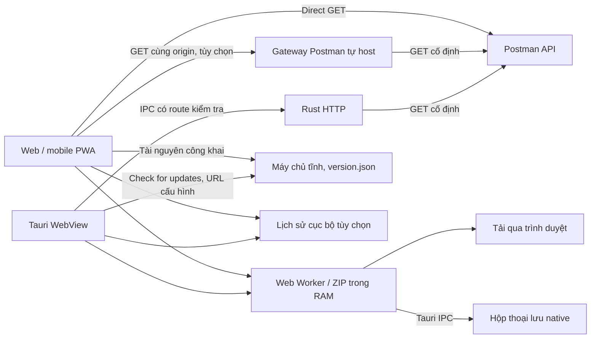

# Thiết kế Torin Tools

Torin Tools là mã nguồn độc lập. Mã ứng dụng, giao diện và icon được viết riêng.

React, TypeScript và Vite phục vụ cả hai giao diện. Rust đảm nhận HTTPS hệ điều hành và quyền ghi tệp ở desktop. Worker làm JSON và ZIP ngoài luồng giao diện. MVP giữ ZIP trong RAM và giới hạn kích thước. API là giới hạn chính về tốc độ tải qua mạng.

Gateway chỉ chuyển tiếp các GET Postman được liệt kê. API key, workspace và JSON đi qua gateway trong RAM khi người dùng chọn relay. ZIP được đóng ở client. Lịch sử lưu tối đa 50 thao tác gồm ID công cụ, mã thao tác đã đăng ký và thời điểm. Service worker cache danh sách file build tĩnh, gồm cả các module lazy-load cần cho offline.

## Thêm công cụ

Vite tự phát hiện `src/tools/<id>/tool.ts` để đăng ký công cụ trong catalog và điều hướng. View được tải riêng khi mở công cụ. ID công cụ là một phần của hash route công khai và lịch sử cục bộ, nên giữ ổn định qua các lần cập nhật.

[Quy chuẩn phát triển công cụ](tool-development.md) quy định cấu trúc thư mục, chọn tiêu chuẩn, lưu tham chiếu và kiểm tra. Xem [danh mục hồ sơ công cụ](tools/README.md) để tra đặc tả hiện hành và các mốc lưu nguồn.
